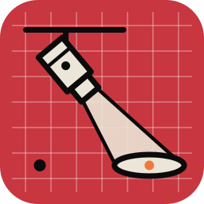
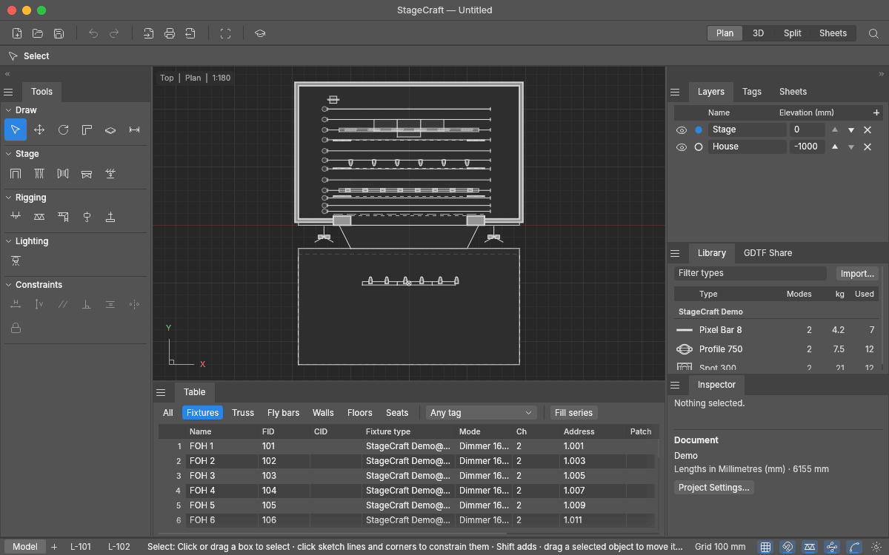
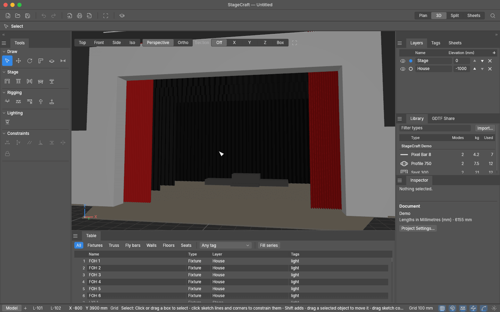
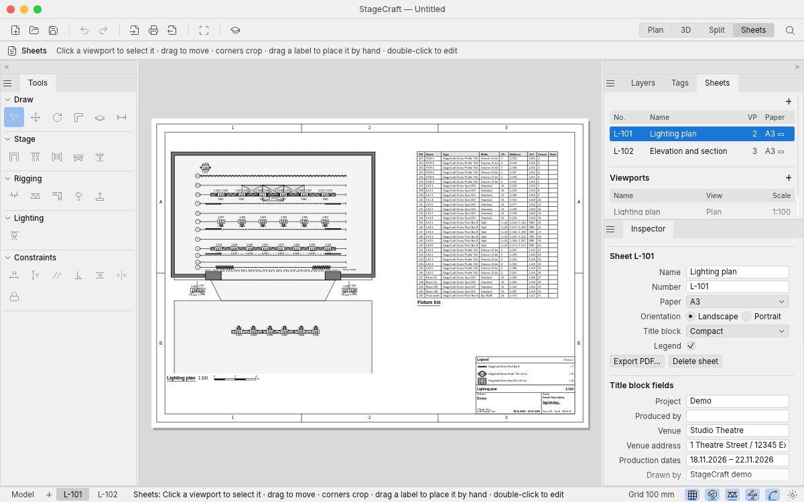
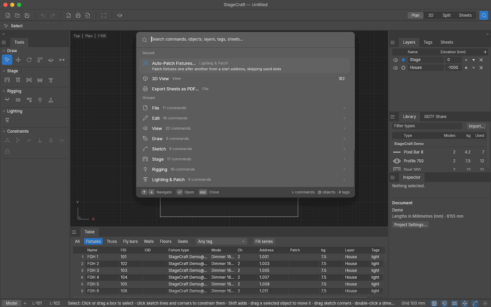
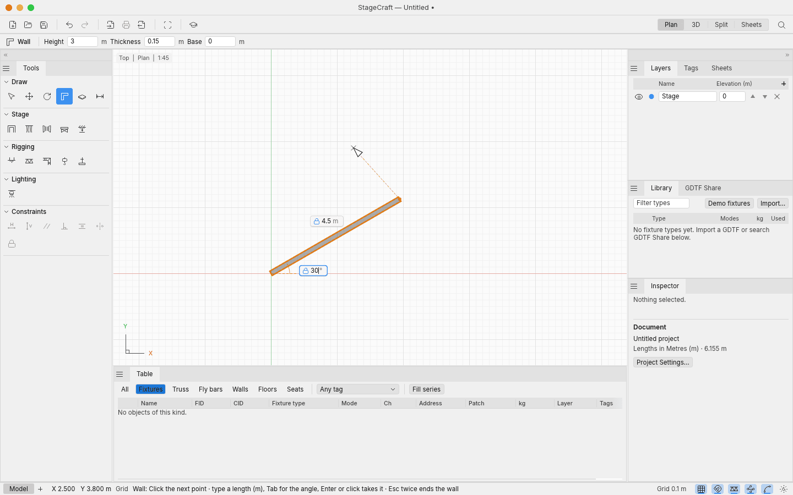
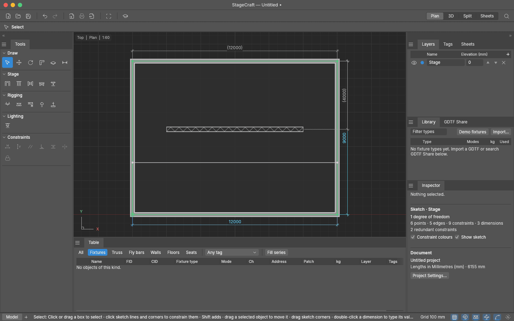

<p align="center">
  
</p>

<h1 align="center">StageCraft</h1>

<p align="center">
  Stage and lighting planning: floor plans, stage machinery, truss, GDTF fixtures, patch,
  3D, and plotted sheets. Native, fast, and fully scriptable.
</p>

<p align="center">
  <a href="https://github.com/RuegerEvents/stagecraft/releases/latest">Download</a> ·
  <a href="docs/spec/overview.md">What it does</a> ·
  <a href="docs/roadmap.md">Roadmap</a>
</p>



StageCraft is a planning tool for theatre, events and touring in the spirit of
Vectorworks Spotlight, built in Rust. Draw the room, set the stage, hang the rig, patch
it and print the plots. Every action is a command, so the same things you do with the
mouse can be done from the command palette, the CLI, a script, or an AI over MCP.

## What it does

- **Rooms as a parametric sketch.** Walls and floors follow a constraint sketch with
  driving dimensions: change the portal width and the stage, the portal and everything on
  it follow. Type lengths while you draw, with heads-up boxes in mm, cm, m or feet and
  inches.
- **Stage objects.** Portals, main curtains (open, closed, gathered), wing sets with legs
  and borders, fly bars with trim heights, platforms with real systems (Bütec,
  Nivoflex), ceilings, seating rows and blocks.
- **Rigging.** Truss in common profiles that joins into runs with corners, bases,
  hoists, and load sums per truss and per fly bar, fixture weights included.
- **Fixtures from GDTF.** Import files or search [GDTF Share](https://gdtf-share.com) from
  inside the app. Real 3D geometry, modes, multi-break patch with conflict checks,
  auto-patch, FID/CID numbering and plan symbols.
- **3D.** A GPU view with orbit, section planes with filled cuts, and the stage from any
  seat in the house.
- **Sheets.** Viewports of plan, elevations, sections, hidden-line views and rendered 3D
  on paper, with labels, legends, fixture lists, title blocks and dimensions. Exported as
  vector PDF or SVG, in English or German.
- **Exchange.** MVR import and export (tested against Vectorworks and grandMA3), glTF,
  OBJ, STL, FBX and 3DS models, plus PDF, SVG, DXF, DWG and image underlays that you can
  calibrate to scale.
- **Made to be driven.** A command palette (⌘K) with German and Vectorworks aliases,
  a local JSON-RPC control channel, a CLI and an MCP server: an AI can build a whole
  venue the same way you would.

| | |
|---|---|
|  |  |
| The stage from the house | Sheets: viewports, labels, legend, title block |
|  |  |
| Command palette (⌘K) | Typed dimensions while drawing |



## Install

Download the latest build from
[Releases](https://github.com/RuegerEvents/stagecraft/releases/latest):

- **macOS (Apple Silicon):** open the `.dmg` and drag StageCraft into Applications.
  The app is not notarized yet, so open it the first time with right-click → Open (or run
  `xattr -dr com.apple.quarantine /Applications/StageCraft.app`).
- **Windows and Linux:** unpack the archive and run `stagecraft`. These builds are new
  and less tested than macOS.

## Build from source

You need a recent stable Rust toolchain (edition 2024).

```sh
cargo run -p stagecraft-app --release      # the app
cargo test                                 # the test suite
scripts/macos-dmg.sh                       # dist/StageCraft-<version>-macos-arm64.dmg
```

On Linux, install the windowing and GTK headers first (see
[`.github/workflows/ci.yml`](.github/workflows/ci.yml) for the list).

## Drive it from the outside

Every function is a command with a JSON schema. A running app announces itself on
`127.0.0.1` with a token; the same binary talks to it.

```sh
stagecraft commands                                  # list every command
stagecraft exec object.list                          # run one in the running app
stagecraft exec sheet.export_pdf '{"path":"plot.pdf"}' --file show.stagecraft
stagecraft serve show.stagecraft                     # headless, no window
```

To let an AI assistant work in StageCraft, add it as an MCP server:

```json
{ "mcpServers": { "stagecraft": { "command": "/Applications/StageCraft.app/Contents/MacOS/stagecraft", "args": ["mcp"] } } }
```

## How it is built

| Crate | What |
|---|---|
| `stagecraft-core` | document model, every command, undo/redo, `.stagecraft` files (builds for WASM) |
| `stagecraft-geom` | plan primitives and meshes for every kind of object, picking, snapping |
| `stagecraft-sketch` | the 2D constraint sketch (solver: [ezpz](https://crates.io/crates/ezpz)) |
| `stagecraft-gdtf` | GDTF reader and GDTF Share client |
| `stagecraft-mvr` | MVR reader and writer |
| `stagecraft-hlr` | hidden-line removal for vector views |
| `stagecraft-sheet` | sheet composition, labels, PDF and SVG |
| `stagecraft-underlay` | PDF, SVG, DXF, DWG and image underlays |
| `stagecraft-control` | JSON-RPC control channel, discovery, MCP server |
| `stagecraft-ui` | the egui interface on the [Craft](https://github.com/storytold/craft-libs) framework |
| `stagecraft-app` | the `stagecraft` binary: app, server, CLI, MCP |

The interface is part of the Craft family of apps and uses
[craft-libs](https://github.com/storytold/craft-libs) for docking, menus, theming and
settings. Design notes live in [`docs/`](docs/), decisions in
[`docs/spec/decisions.md`](docs/spec/decisions.md).

## License

[MIT](LICENSE). Bundled fonts, icons and other third-party material keep their own
licenses; see [`THIRD_PARTY.md`](THIRD_PARTY.md).
